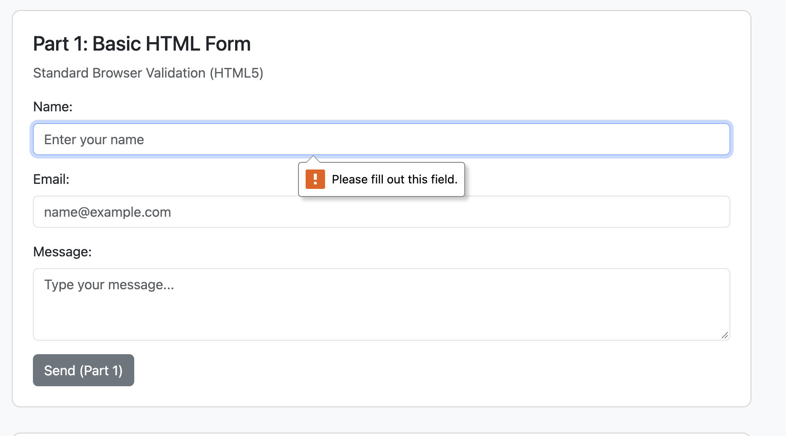
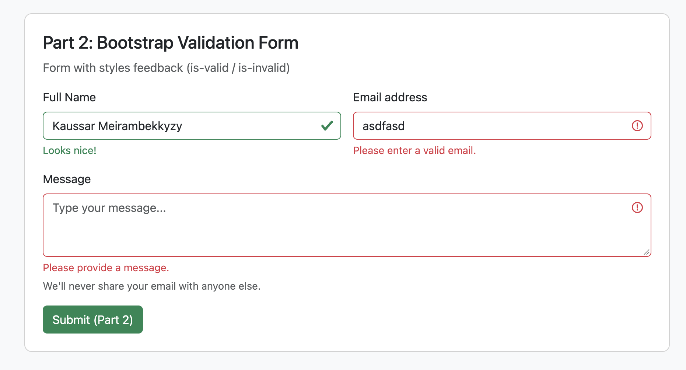
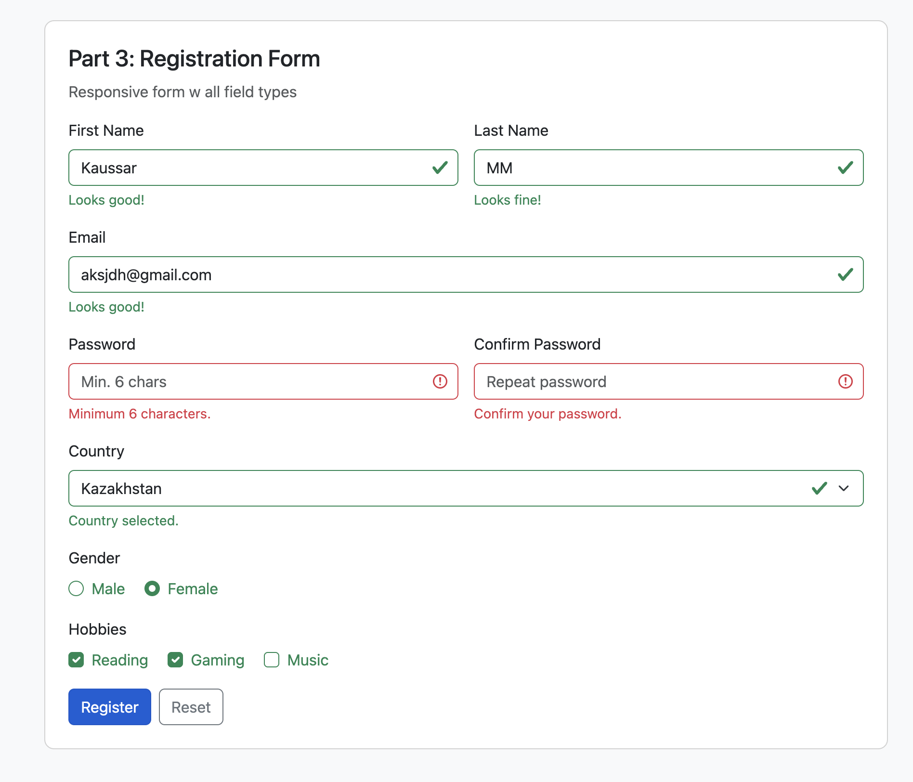

# Assignment 4: Forms and Validation

- **Student:** Kaussar Meirambekkyzy  
- **Group:** IT-2513

## Project Overview
In this assignment, I practiced working with HTML forms, adding validation, and styling them using Bootstrap 5. The project has 3 main parts: basic HTML5 form validation, Bootstrap validation styles, and a full responsive registration form.

---

## Tasks & Screenshots

### Part 1: Basic HTML Form (Task 0 & Task 1)
- Created a simple contact form with inputs for Name, Email, and Message.
- Used `<label>` for each input.
- Added native HTML5 validation attributes (`required`, `type="email"`, `maxlength`).
- Tested how the browser blocks empty or wrong inputs by default.

**Screenshot:**

---

### Part 2: Bootstrap Contact Form (Task 2 & Task 3)
- Recreated the contact form using Bootstrap classes (`form-control`, `form-label`, `form-text`).
- Used Bootstrap Grid (`row`, `col-md-6`) for layout.
- Added `.valid-feedback` and `.invalid-feedback` classes to show success and error messages below inputs.

**Screenshot:**

---

### Part 3: Registration Form (Task 4)
- Built a registration form with different types of inputs:
  - First Name & Last Name (text inputs)
  - Email
  - Password & Confirm Password (with `minlength="6"`)
  - Country (dropdown select)
  - Gender (radio buttons)
  - Hobbies (checkboxes)
  - Submit and Reset buttons
- Made it fully responsive with Bootstrap Grid.
- Used a simple script to trigger Bootstrap's `.was-validated` state on submit, and added functionality to clear validation when clicking Reset.

**Screenshot:**

---

## Summary of Work Process
1. First, I created the simple HTML form to see how default browser validation works without extra styling.
2. Then, I styled the contact form with Bootstrap 5 and set up feedback messages for valid and invalid inputs.
3. Finally, I built the full registration form with different input types and connected the Bootstrap validation script.
4. Tested all forms, checked button actions (Submit and Reset), and verified that everything works without errors.